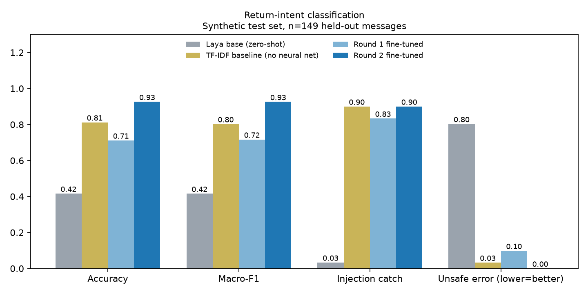
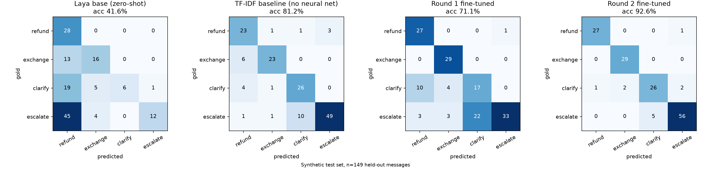
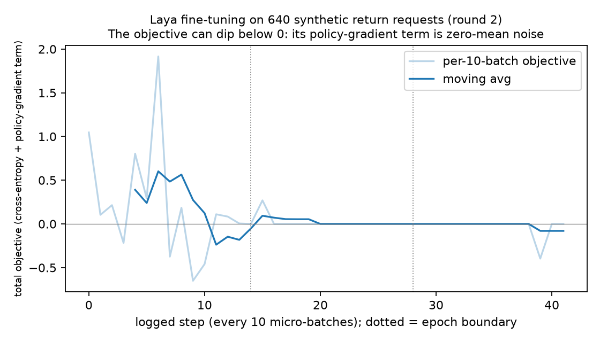
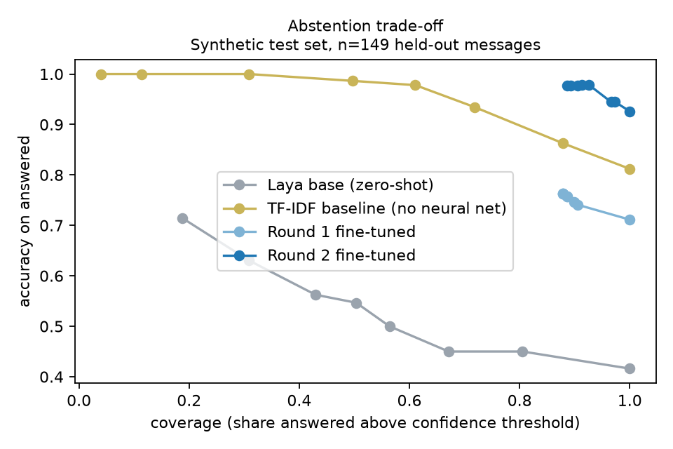

# Fine-tuning a typed decision model for return-request routing

Fine-tuning [Laya](https://github.com/NandhaKishorM/laya) (Convai Innovations, open source, 421M parameters) to route customer
return requests into four **typed** outcomes (`refund`, `exchange`, `clarify`, `escalate`), measured honestly over two rounds:
baseline, error analysis, targeted data fix, and a fresh test set.



## Result (fresh test set, 149 messages, all unique)

| | Base Laya (zero-shot) | TF-IDF baseline (no neural net) | Round 1 fine-tune | Round 2 fine-tune |
|---|---|---|---|---|
| Accuracy | 41.6% | 81.2% | 71.1% | **92.6%** |
| Macro-F1 | 0.42 | 0.80 | 0.72 | **0.93** |
| Escalations auto-approved as refund/exchange ("unsafe") | 49 / 61 | 2 / 61 | 6 / 61 | **0 / 61** |
| Injection messages routed to `escalate` | 1 / 30 | 27 / 30 | 25 / 30 | 27 / 30 |
| Calibration error (ECE) | 0.28 | 0.15 | 0.23 | **0.04** |

Round 2 by category: plain 98%, injection 90%, other escalations (human request, fraud, safety, legal) 94%, ambiguous 84%.
A confidence gate at 0.7 sends 8.7% of messages to a person and raises accuracy on the rest to 97.8%.

**The cheap baseline is strong, and that matters.** A TF-IDF + softmax-regression classifier (about 40 lines of NumPy, no neural
network, trained on the same 640 messages) scores 81% and catches the injection messages as often as fine-tuned Laya (27/30).
Fine-tuned Laya adds about 11 accuracy points, better calibration, and 56/61 vs 49/61 escalations recalled, mostly on the
plain and non-injection escalation categories. Part of why bag-of-words does so well here is that the data is templated:
the test messages share vocabulary with the training templates. On real customer text the gap between the two would likely
look different, in either direction. Base Laya's weakness is zero-shot use, not the task being hard.
Full numbers: [`results/round2/results.json`](results/round2/results.json). Per-message predictions: `results/round2/predictions.json`.

**Please read the caveats below before quoting these numbers.**

## What happened

1. **Task and labelling rules written first** (see the docstring of `scripts/01_make_dataset.py`). Example: "refund or swap, I don't
   mind" is `clarify`; "a bigger size, or my money back if you're out of stock" is `exchange`.
2. **Baselines.** The untouched model, scored before any training, plus a no-neural-network TF-IDF classifier on the same data.
3. **Round 1.** Fine-tune on 600 synthetic messages. The training objective goes to about zero, which on templated data proves nothing.
   Held-out error analysis showed the failures clustered: requests for a human, account fraud, injury reports and fake
   "your system already approved this" claims. None of those patterns were in the training data. Six of the eleven errors
   had confidence 1.00. This was a **data-coverage gap**, not a model limit.
4. **Round 2.** Same model, same hyperparameters. Only the data changed: new training templates for those gaps (640 messages)
   and a **brand-new test set** with different wording, de-duplicated and checked for overlap with training. The round-1 model
   is scored on the same new test set, so the comparison is like for like.



| Training objective | Accuracy vs coverage |
|---|---|
|  |  |

## Caveats (important)

- **Synthetic data, written by me.** Training and test templates were both written by the same person. Round 2's test set
  covers categories that round 2's training data covers too (with different wording). The gain mostly shows that *targeted data fixes
  targeted failures*. It does not show production accuracy.
- **Small test set.** 149 messages; one message is 0.7 points. Do not read meaning into differences of a point or two.
- **One run per round.** No seeds were repeated, so run-to-run variance is unknown.
- **Residual failures.** 11 errors remain. Five escalations went to `clarify`: not auto-approved, but not handed to a person either.
  Two genuine ambiguities were guessed at 0.99 confidence.
- **The model is not the whole safety story.** Refund amounts and policy windows belong in ordinary code, not in a classifier.
- **Vendor numbers are the vendor's.** Laya's published benchmarks are theirs; nothing here reproduces them.
- The round-1 numbers in `results/round1/` were measured on a *different* test set (`results/round1/test_round1.jsonl`, 125 rows, 7
  duplicates). Don't compare them directly with the table above.

## Reproduce

Python >= 3.10. The base weights and trained weights are **not** in this repo (large); they are downloaded or trained.

```bash
pip install -r requirements.txt

python scripts/01_make_dataset.py       # writes data/train.jsonl (640) and data/test.jsonl (149); deterministic (seed 11)

# fine-tune (downloads the base model on first run; works on CPU, CUDA or Apple MPS)
python scripts/02_finetune.py --model-dir ./models/laya_base --epochs 3 --micro-batch 4 --grad-accum 8

# score: base model, the TF-IDF baseline, and the new model (add `round1` if you saved that model in ./models/round1)
python scripts/03_evaluate.py --arms base,tfidf,finetuned
python scripts/04_plot_results.py       # PNGs into results/round2/plots/
python scripts/05_inspect_errors.py     # every remaining mistake, highest confidence first
```

`scripts/03_evaluate.py --arms claude` scores an LLM classifier on the same test set (needs `ANTHROPIC_API_KEY`).
Fine-tuning hyperparameters: 3 epochs, micro-batch 4 x grad-accum 8 (effective batch 32), AdamW with encoder lr 2.5e-5 and
head lr 1e-4, cosine schedule, gradient checkpointing, 10% of items held out to fit a calibration temperature.

## Repository layout

```
scripts/                       the pipeline, in the order you run it
  01_make_dataset.py             build the synthetic train and test sets
  02_finetune.py                 fine-tune Laya (adapted from the official example)
  03_evaluate.py                 score base / TF-IDF baseline / fine-tuned models
  04_plot_results.py             confusion matrices, comparison bars, training curve, abstention curve
  05_inspect_errors.py           list the remaining mistakes
data/                          synthetic datasets (train.jsonl, test.jsonl, questions.json)
results/
  round2/                        final run: results.json, predictions.json, training_log.csv, plots/
  round1/                        archived first run (different test set; not comparable)
models/                        weights, git-ignored (downloaded / trained locally)
```

## Credits and license

- Fine-tuning script adapted from the official Laya example `notebooks/laya_finetune_typed_decisions_mps.py`
  ([NandhaKishorM/laya](https://github.com/NandhaKishorM/laya), Apache License 2.0), with modifications noted in the file header.
- Laya model: [`convaiinnovations/laya`](https://huggingface.co/convaiinnovations/laya); docs at nandhakishorm.github.io/laya.
- This repository is released under the Apache License 2.0 (see `LICENSE`).

